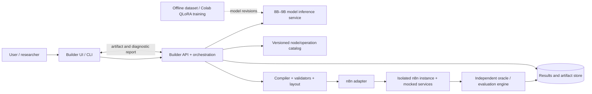
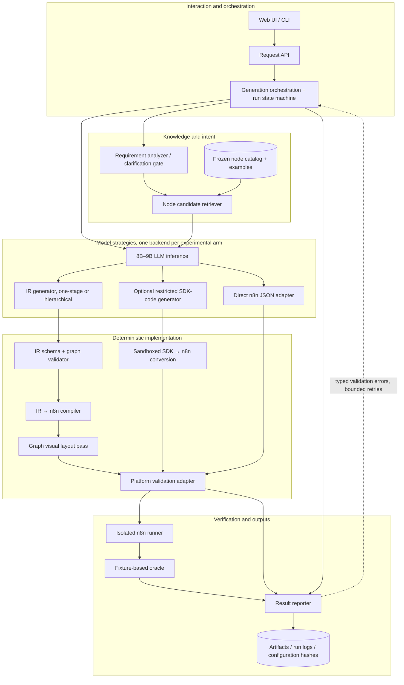
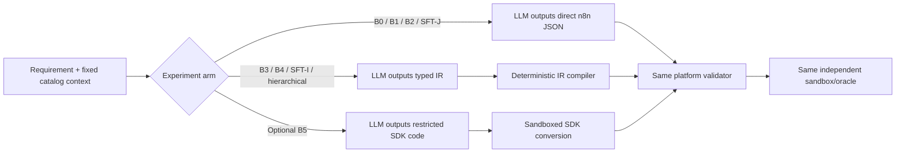
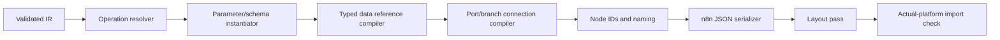
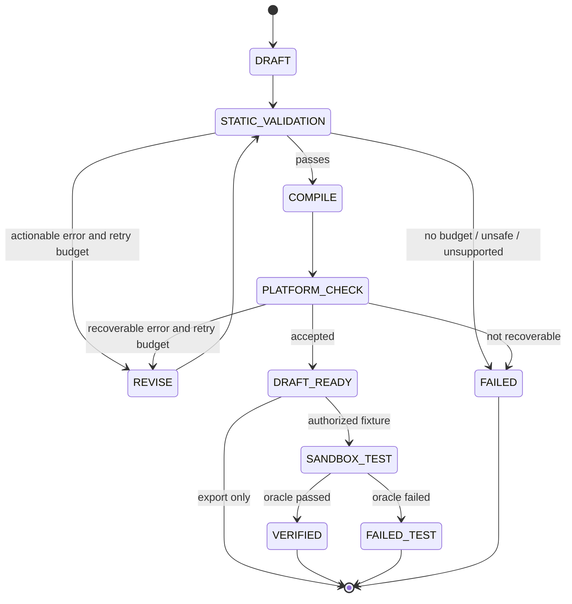
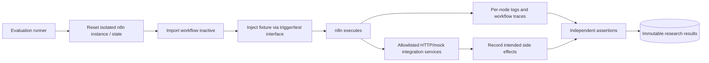
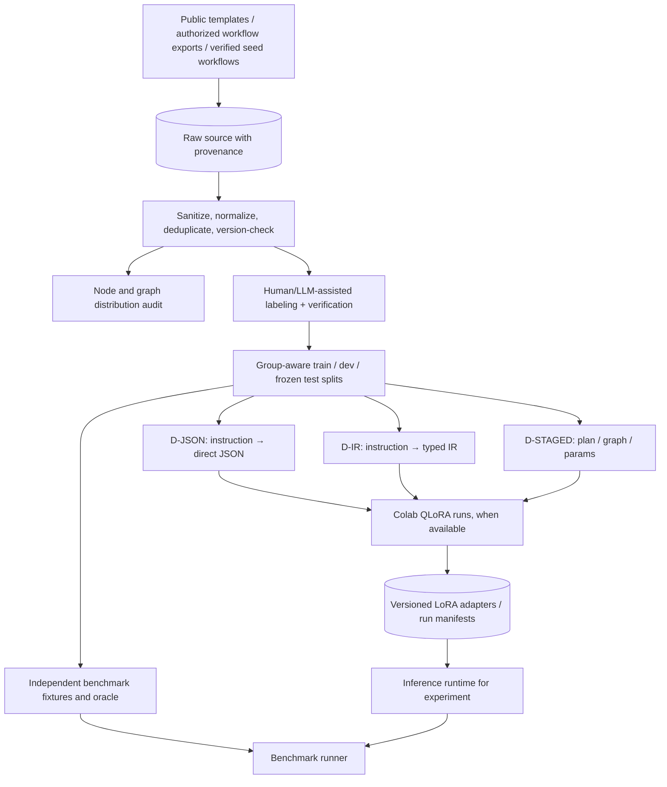
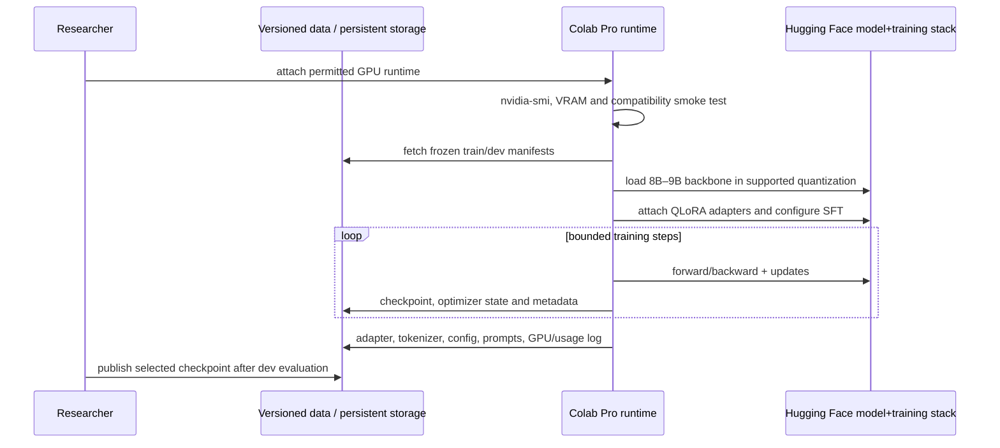
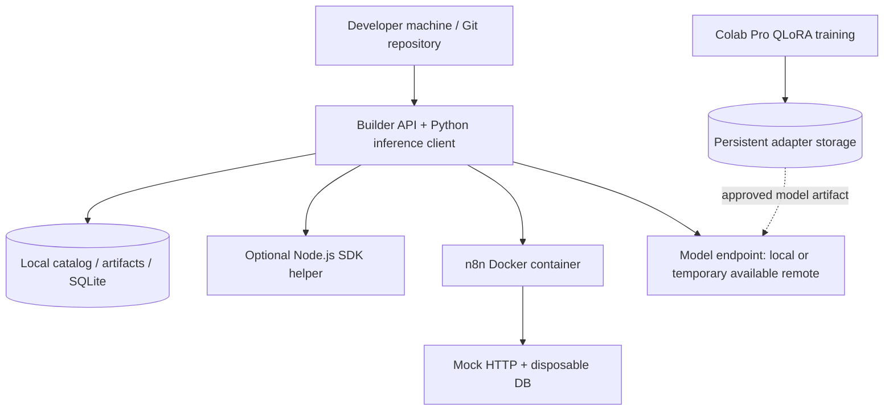
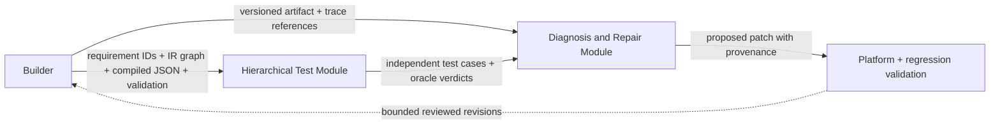

# LexaFlow Builder — Full System Architecture

## Reference architecture, service contracts, data model, workflows, evaluation paths and deployment

Current repository layout (26 October 2026): `src/builder/{reader,validator,inventory}.py`
implements the static inventory only. Tests are flat under `tests/`; consolidated
research plans, inventory contract and milestone evidence are in [milestones.md](milestones.md).
The components below describe future candidate architecture, not current packages.

**Version:** 1.0 — candidate architecture, to be validated through experiments  
**Date:** 23 October 2026  
**Companion document:** [Research plan and milestones](milestones.md)  
**Objective:** Natural-language requirement → readable, correctly configured, n8n-importable, independently testable explicit automation workflow using an 8B–9B open-weight language model.  
**Platform principle:** n8n is a **pluggable backend for compilation and controlled execution**, not the target of the scientific contribution.

> **Design status:** The candidate architecture below prioritizes a typed IR + deterministic compiler with a single model, optional retrieval, and bounded validation feedback. This is **not** established as best; direct n8n JSON and SDK-code paths remain formal experimental alternatives. Interfaces should allow them to be compared without modifying evaluation ground truth.

---

**Standalone overview diagram:** [PNG](LexaFlow_Builder_Architecture_Overview.png) · [Scalable SVG](LexaFlow_Builder_Architecture_Overview.svg) · [Editable Graphviz source](LexaFlow_Builder_Architecture_Overview.dot)


# 1. System responsibilities and non-goals

## 1.1 Responsibilities

1. Interpret and preserve natural-language constraints (trigger, operations, data flow, conditions, side effects).
2. Identify missing critical information, unsupported operations, and environment-dependent values.
3. Ground node selection against a **frozen, versioned operation catalog**.
4. Generate a structured workflow using an 8B–9B model, directly or in stages.
5. Convert model output to an exact n8n artifact through a compiler or tested SDK route.
6. Validate syntax, graph/port structure, operation/parameter constraints, and platform import.
7. Apply deterministic visual layout, preserving workflow semantics.
8. Run only **explicitly authorized, isolated fixtures** and record independent test outcomes.
9. Persist all provenance, diagnostics, model/configuration hashes, and research measurements.
10. Expose safe, transparent results and handoff artifacts to LexaFlow's separate testing/repair research modules.

## 1.2 Non-goals

- Auto-activating generated workflows or using real credentials by default.
- Autonomous execution of arbitrary generated JavaScript/TypeScript.
- Guaranteeing arbitrary external integrations work in isolation.
- Conflating import success, runtime success, and correct behavior.
- Claiming n8n-independent empirical generalization without adding another backend to the benchmark.

---

# 2. Architecture overview

## 2.1 Context / external actors



**Separation of concerns:** Colab is primarily an **offline experimental/training environment**. The Builder's inference service is a distinct runtime with a replaceable implementation. Do **not** assume that a $10/month Colab Pro notebook provides guaranteed, persistent 24/7 model hosting. For a demo, use a transient notebook endpoint only when connected and permitted, otherwise a local/approved inference endpoint or a demonstration replay.

## 2.2 Main component diagram



**Diagram interpretation:** an experimental run activates **one** of direct JSON, IR, or SDK output paths. Those branches are **alternatives**, not three consecutive LLM steps. Model adaptation, retrieval and staging are controlled experimental factors.

---

# 3. Core subsystems: duties, inputs, outputs, evidence and failure policy

| Component                   | Primary responsibility                                           | Input                                       | Output                              | Error/limit behavior                                         |
| --------------------------- | ---------------------------------------------------------------- | ------------------------------------------- | ----------------------------------- | ------------------------------------------------------------ |
| **UI/CLI**                  | Accept requirement, show preview and diagnostics                 | Natural language, optional preferences      | `GenerationRequest`                 | Refuse to claim deployment success without verified checks.  |
| **API gateway**             | AuthN/AuthZ, request versioning, validation, run ID              | JSON request                                | Accepted/rejected request           | No secret values in logs.                                    |
| **Orchestrator**            | Select experiment arm, pass contexts, track retry budget         | Requirement + `ExperimentConfig`            | `GenerationRun`                     | Enforce bounded retries and timeout; do not spin forever.    |
| **Requirement analyzer**    | Extract trigger, condition, action, bindings and missing details | User text                                   | `RequirementSpec`                   | Ask for required unknowns or leave typed placeholders.       |
| **Catalog retriever**       | Select existing node/operation descriptions                      | `RequirementSpec`, catalog ID               | Candidate operation IDs and schemas | Never invent unknown operations; log retrieval failures.     |
| **Model inference adapter** | Tokenize/prompt/decode selected 8B–9B model                      | Prompt, candidates, strategy ID             | Raw output + usage/latency          | Guardrails: max tokens, timeouts, stop tokens.               |
| **IR validator**            | Parse, check typed grammar and referential integrity             | Proposed IR                                 | Valid IR or diagnostics             | Fail closed on unsupported ports/types.                      |
| **Compiler**                | Resolve operations and materialize n8n artifact                  | Valid IR + catalog                          | `WorkflowArtifact`                  | No arbitrary coercion or synthetic credentials.              |
| **Visual layout**           | Stable coordinates, names, annotation                            | Graph + settings                            | Positioned artifact                 | Should not mutate runtime semantics.                         |
| **Platform adapter**        | Import/check workflow on version-locked n8n                      | Serialized JSON                             | Import result and platform errors   | Version-specific diagnostics; no production activation.      |
| **Sandbox runner**          | Reset, execute controlled input scenarios, collect effects       | Artifact + fixture ID                       | `ExecutionTrace`                    | Deny non-allowlisted network/filesystem side effects.        |
| **Oracle/evaluator**        | Verify intended behavior independently                           | Requirement case, fixture, recorded effects | Pass/fail + assertions              | Oracle must not be dynamically authored by generating model. |
| **Experiment store**        | Immutable record of provenance/results                           | All run artifacts                           | Reproducible run bundle             | Store hashes, not secrets.                                   |

### Offline components

**Dataset ETL and auditing** collects, sanitizes, deduplicates, profiles, labels, and group-splits workflows. **Catalog extraction** snapshots supported operations from the installed platform plus official documentation. **Trainer** runs QLoRA in Colab subject to VRAM constraints and stores adapters/checkpoints in durable storage. **Evaluator** runs paired comparisons on a frozen benchmark. These are distinct from the online Builder.

---

# 4. Online workflow: exact processing sequence

## 4.1 Candidate IR pipeline: sequence diagram

```mermaid
sequenceDiagram
    autonumber
    actor U as User
    participant API as Builder API
    participant O as Orchestrator
    participant K as Catalog / Retriever
    participant M as 8B–9B Model
    participant V as IR Validator
    participant C as Compiler + Layout
    participant N as n8n Sandbox Adapter
    participant E as Independent Evaluator
    U->>API: requirement, mode, target catalog version
    API->>O: create run and persist request hash
    O->>O: parse constraints / missing critical fields
    alt Required detail missing
        O-->>API: NEEDS_CLARIFICATION + typed fields
        API-->>U: request exact missing information
    else Sufficient to draft
        O->>K: retrieve permissible operations/schemas
        K-->>O: ranked candidates + sources
        O->>M: build prompt; emit bounded IR
        M-->>O: raw candidate + token counts
        O->>V: parse and validate
        alt Invalid or unsupported
            V-->>O: diagnostics
            opt Within retry budget
                O->>M: localized correction prompt
                M-->>O: revised IR
                O->>V: validate again
            end
        end
        alt Valid IR
            O->>C: compile + layout
            C-->>O: n8n JSON + unresolved config
            O->>N: platform import (inactive, isolated)
            N-->>O: import status and errors
            opt Authorized fixture test requested
                O->>N: reset fixture and execute safely
                N-->>E: outputs, traces and side effects
                E-->>O: independent oracle verdict
            end
        end
        O-->>API: final artifact, status, diagnostics, run manifest
        API-->>U: preview/export/results
    end
```

A user request can have a workflow **draft** even if credentials are missing. Its final status must reflect exactly which checks passed. The UI should not show `EXECUTABLE` unless it has actually been executed in a defined environment, and should not show `PRODUCTION_READY` unless deployment prerequisites have been satisfied and approved.

## 4.2 Generation modes are swappable



**Scientific requirement:** every arm uses an identical frozen _task specification, allowed operations, platform version, and oracle_. Differing generation representations and compiler assistance are measured experimental treatments, not secretly normalized away.

---

# 5. Domain schemas and contracts

The following are **proposed LexaFlow internal contracts**, not official n8n or SDK APIs. Each schema requires a version number and validation.

## 5.1 `GenerationRequest`

```json
{
  "request_id": "req_001",
  "text": "When an order arrives, alert sales if total exceeds 500",
  "mode": "IR_RAG_ZERO_SHOT",
  "target_platform": "n8n",
  "catalog_version": "n8n-snapshot-2026-10-v1",
  "allow_clarification": true,
  "evaluate_in_sandbox": false,
  "constraints": {
    "max_nodes": 12,
    "allowed_operation_ids": null,
    "external_side_effects": "disabled"
  }
}
```

**Never** allow an arbitrary user payload to override server-side sandbox safety policy.

## 5.2 `RequirementSpec`

```json
{
  "spec_version": "0.1",
  "task_id": "task_001",
  "trigger": { "kind": "incoming_order", "source": "unspecified" },
  "requirements": [
    { "id": "r1", "predicate": "order.total > 500" },
    { "id": "r2", "action": "notify_sales", "when": "r1" }
  ],
  "must_clarify": ["order_source"],
  "deployment_prerequisites": ["sales_notification_destination", "credentials"],
  "assumptions": []
}
```

Use controlled enums/types in production instead of unconstrained free-form fields. Track **source spans** from natural-language instruction to requirements when feasible for coverage analysis. A clarification is appropriate for a logically essential missing value; a credential name can be represented as a typed deployment placeholder.

## 5.3 `WorkflowIR`

This IR is a _workflow graph_, not a finished n8n object. It must express at least:

- Nodes with unique symbolic IDs, canonical **operation** IDs and typed arguments.
- Edges with explicit `from`, `from_port`, `to`, `to_port`.
- Structured predicates and branch mappings; support loops/merge semantics without DAG-only assumptions.
- Data bindings with `upstream_node`, `field_path`, `value_type`, and optional item/iteration context.
- Source requirement IDs for traceability.
- Unresolved values with type and origin (`user_input`, `credentials`, `dynamic_schema`, `external_resource`).
- Warnings and assumptions as separate metadata, never embedded as runtime operations.

**Sample** (illustrative grammar; details must be finalized in schema tests):

```json
{
  "ir_version": "0.1",
  "name": "High value order alert",
  "nodes": [
    {
      "id": "trigger",
      "operation": "trigger.webhook",
      "args": { "path": "orders" },
      "covers": ["r0"]
    },
    {
      "id": "gate",
      "operation": "control.if",
      "args": {
        "left": {
          "ref": { "node": "trigger", "path": "order.total", "type": "number" }
        },
        "operator": "gt",
        "right": 500
      },
      "covers": ["r1"]
    },
    {
      "id": "alert",
      "operation": "slack.send_message",
      "args": {
        "destination": { "unresolved": "sales_channel" },
        "text": "High-value order arrived"
      },
      "covers": ["r2"]
    }
  ],
  "edges": [
    { "from": "trigger", "from_port": "main", "to": "gate", "to_port": "main" },
    { "from": "gate", "from_port": "true", "to": "alert", "to_port": "main" }
  ],
  "unresolved": [
    { "key": "sales_channel", "type": "channel_id", "reason": "not supplied" }
  ]
}
```

## 5.4 `NodeCatalogEntry`

```json
{
  "catalog_version": "n8n-snapshot-2026-10-v1",
  "operation_id": "slack.send_message",
  "n8n_node_type": "n8n-nodes-base.slack",
  "n8n_type_version": "PINNED_IN_CATALOG",
  "resource": "message",
  "operation": "post",
  "description": "Post a message to an allowed Slack destination",
  "required_arguments": ["channel", "text"],
  "conditional_argument_rules": [],
  "credential_requirement": "slackOAuth2Api",
  "input_ports": ["main"],
  "output_ports": ["main"],
  "example_ids": ["ex_slack_001"],
  "authority": "verified_installed_node_metadata"
}
```

**Caution:** exact Slack resource/operation IDs, parameter shapes and credential names vary across n8n versions. The values above are illustrative and **must be replaced with data extracted from the pinned installed node definition**. Never turn the example into a hard-coded source of truth.

## 5.5 `WorkflowArtifact` and `ValidationReport`

```json
{
  "artifact_id": "art_001",
  "target": "n8n",
  "target_version": "PINNED_VERSION",
  "source_ir_hash": "sha256:...",
  "workflow_json_path": "artifacts/art_001/workflow.json",
  "layout": { "engine": "dagre", "settings_hash": "sha256:..." },
  "unresolved": ["sales_channel", "credentials"],
  "checks": {
    "parse": "pass",
    "typed_graph": "pass",
    "operations": "pass",
    "parameters": "incomplete_environment_values",
    "n8n_import": "pass",
    "sandbox_runtime": "not_run",
    "semantic_oracle": "not_run"
  }
}
```

Avoid one ambiguous Boolean such as `valid=true`. Return per-layer checks with `pass`, `fail`, `blocked`, `skipped`, and structured issue codes.

## 5.6 `ExperimentRun`

Minimum immutable fields: `run_id`, `task_id`, `requirement_hash`, `dataset_manifest_id`, `split`, `generator_mode`, `model_id`, `model_revision`, `adapter_id`, `tokenizer_id`, `prompt_template_id`, `catalog_hash`, `n8n_version`, `sdk_version_if_used`, `decoder_config`, `retrieved_operation_ids`, `generation_attempts`, `raw_outputs`, `compiled_artifact_hash`, `validator_report`, `execution_fixture_id`, `oracle_result`, `tokens`, `wall_time`, `gpu_memory_if_measured`, `seed`, `timestamp`. Store raw text only after redaction and access control.

---

# 6. Compiler internals

## 6.1 Modules and order



### Operation resolver

- Resolve canonical `operation_id` using a pinned catalog; **never fuzzy-pick an unsupported operation without recording an explicit choice**.
- Validate node type version, selected resource/operation and conditional required fields.
- Return `OP_NOT_FOUND`, `NODE_VERSION_UNAVAILABLE`, `AMBIGUOUS_OPERATION`, etc.

### Parameter instantiator

- Use exact operation-specific field names and shape.
- Distinguish literal values, formulas, upstream bindings, deferred user details and credential requirements.
- Do not fill unknown spreadsheet IDs / channels / API secrets from hallucinated values.
- Build per-operation semantic checks that general JSON Schema cannot capture.

### Data-binding compiler

- Resolve source and target nodes, field paths, item linking and execution path.
- Check type compatibility conservatively; static checks cannot fully know dynamic API schemas.
- Detect references to nodes that may not execute on the same branch, or report uncertainty instead of claiming correctness.

### Edge/branch compiler

- Map named ports to correct n8n connector indices; enforce conditional branch semantics.
- Check reachable nodes, orphaned operations and invalid input/output attachments.
- Handle joins and loops intentionally; do **not** reject valid cyclic flow indiscriminately.

### Serializer, layout and import verifier

- Preserve graph semantics and node parameter values through coordinate assignment.
- Use deterministic layout with configurable horizontal/vertical orientation, padding and ordering.
- Check import using the **actual installed n8n version**; schema checks alone do not prove importability.

## 6.2 Compiler tests

- **Unit:** each supported operation and variant/required-field rule.
- **Property-based:** unique identifiers, valid edge endpoints, deterministic layout, stable serialization, no secret fabrication.
- **Round-trip:** import selected gold fixtures and check graph/parameter equivalence after compile/export, allowing non-semantic formatting differences.
- **Behavioral:** evaluate a representative subset end-to-end in sandbox.
- **Mutation:** corrupt a known good IR (dangling reference, wrong branch, wrong required field) and confirm the diagnostic is specific, not a generic parser failure.

---

# 7. Knowledge and retrieval architecture

## 7.1 Catalog sources and authority

1. **Highest authority:** installed n8n node definitions and exact supported versions in frozen runtime.
2. **Supporting:** official node documentation and source code linked to the pinned version.
3. **Examples:** reviewed working workflows.
4. **Weak text:** public descriptions/blog examples; contextual only, not schema authority.

Catalog index should preserve provenance, extraction date, and version. Dynamic parameter options dependent on live credentials/resource choices must be marked as such and never confidently invented offline.

## 7.2 Retriever steps

1. Use semantic requirement to choose an initial operation category.
2. Filter by installed catalog, allowed operations, platform version and security policy.
3. Hybrid lexical/embedding retrieval for candidate operations.
4. Optional rerank using operation intent and required input/output types.
5. Retrieve short field schemas plus, if permitted, verified examples.
6. Return bounded set with IDs, evidence, and retrieval confidence/score.
7. Log retrieval recall on cases with annotated required operations.

## 7.3 Retrieval errors as independent failure class

Measure `required_operation_recall@k`, `false_candidate_rate`, `unsupported_operation_rate`, and _generation success conditioned on correct retrieval_. A good generator cannot choose an operation withheld by the catalog/filter. Distinguish retriever failures from planner failures.

---

# 8. Model inference service and prompts

## 8.1 Adapter interface

```python
class Generator:
    def generate(self, requirement, context, config):
        """Return raw output, token usage, latency, model revision, warnings."""
        ...
```

Implement separate _strategy adapters_ rather than embedding conditional logic everywhere:

- `DirectJsonGenerator`
- `IRGenerator`
- `HierarchicalIRGenerator`
- `RestrictedSdkGenerator` (optional)
- `RepairFromDiagnosticsGenerator` (bounded optional)

Each uses a common model inference backend, enabling the same backbone and decoding policy to be reused across experiments.

## 8.2 Prompt information hierarchy

1. System constraints: supported grammar, exact output format, refusal/unknown policies, no credential fabrication.
2. Original requirement and resolved clarification answers.
3. Authorized candidate operations and _authoritative_ parameter contracts.
4. Optional retrieved examples explicitly marked as lower-trust reference material.
5. Task request: choose correct operations and generate valid output.
6. Structured diagnostic report on revision runs only.

Retrieved documentation and public workflow examples are **data**, not instructions to override the system constraints. Sanitize and delimit them to mitigate prompt injection.

## 8.3 Hierarchical model contract

- **Plan call:** requirement → structured steps, predicates, required fields, requirement coverage.
- **Topology call:** plan + operation catalog → graph with typed ports and dependencies.
- **Configuration call:** graph + operation field contracts → parameter arguments and expressions.
- **Assembler:** deterministic merge into IR, preserving provenance of each generated field.

Do **not** treat separate calls as multiple distinct trained agents unless that is an intentionally evaluated design. The cheapest baseline is a single model prompted differently.

## 8.4 Bounded feedback design



`REVISE` may be disabled in a baseline. Always record outcomes **before** correction.

---

# 9. Evaluation, test environment and benchmark independence

## 9.1 Controlled test environment



**Examples of safe fixtures:** self-hosted HTTP mock server, temporary spreadsheet-like service, dummy Slack endpoint, disposable database; all reset per task. External network egress should be denied by default where feasible.

## 9.2 Oracle ownership and independence

- Benchmark designer writes requirements and expected outputs **before** model evaluation; human review where possible.
- Do not use generated workflow JSON as the only correct answer.
- Do not allow LLM that generates the artifact to freely change the oracle.
- Tests must include positive and negative/threshold boundaries where semantically meaningful.
- Keep test seeds, mocked responses, timeouts, locale and timezone pinned.

## 9.3 Multi-layer report (example)

```json
{
  "task_id": "order_threshold_001",
  "first_pass": {
    "parse": true,
    "graph_valid": true,
    "importable": true,
    "executed": true,
    "task_satisfied": false
  },
  "assertions": [
    { "id": "amount_600", "status": "pass" },
    {
      "id": "amount_500",
      "status": "fail",
      "reason": "sent notification on equality"
    }
  ],
  "root_failure_candidates": ["wrong_condition"],
  "post_correction": null,
  "context": { "n8n_version": "PINNED_VERSION", "fixture_id": "fx_001" }
}
```

**Interpretation:** import and execution success did not imply requirement satisfaction. Store exact predicate semantics and evidence.

## 9.4 Research experiment families

- **E1 representation:** direct JSON vs IR+compiler vs optional SDK code; same tasks and backbone.
- **E2 retrieval:** none vs operation doc vs operation+example.
- **E3 SFT:** untuned vs matched JSON-SFT vs matched IR-SFT.
- **E4 training coverage:** natural vs random/stratified/targeted augmentation.
- **E5 staging:** one-pass IR vs plan/graph/config calls.
- **E6 correction:** no feedback vs one/two bounded passes.

Persist per-task outputs and failure class. Use paired task-level comparisons, confidence intervals and latency/cost distributions.

---

# 10. Offline training and data architecture



**Leakage warning:** independent fixture labels and test requirements must not be generated from the same training workflow templates without careful group separation and independent verification.

## 10.1 Data artifacts

```text
data/
  raw/{source}/
  normalized/
  provenance/source_manifest.jsonl
  annotations/requirement_pairs.jsonl
  operation_catalog/{catalog_version}/
  splits/{split_version}/{train,dev,test}.jsonl
  fixtures/{case_id}/input.json
  fixtures/{case_id}/oracle.json
  audit/rejection_reasons.csv
  audit/graph_motif_frequency.csv
```

## 10.2 Colab training sequence (do not confuse with application serving)



**Hardware realism:** Colab paid plans do not guarantee GPU type, duration, or compute units consumed per unit time. First train a tiny slice and measure actual throughput. Preserve enough intermediate state to recover from routine preemption. Running a model in Colab for an interactive demo is possible while the runtime exists, but it is **not guaranteed persistent hosting**.

---

# 11. Storage and database design

For MVP, SQLite + filesystem/Drive artifacts may suffice. Use PostgreSQL only if multi-user access/concurrency needs it; object storage or versioned files for large blobs.

### Suggested logical tables

| Table                 | Key fields                                                       | Notes                                  |
| --------------------- | ---------------------------------------------------------------- | -------------------------------------- |
| `requirements`        | request ID, text hash, source, clarification state               | Protect sensitive text.                |
| `catalog_versions`    | hash, n8n version, operation count, snapshot location            | Immutable after experiments start.     |
| `models`              | revision ID, tokenizer, architecture, adapter, license           | No ambiguous aliases such as `latest`. |
| `datasets`            | manifest ID, provenance tiers, split hash, normalization version | Link lineage.                          |
| `runs`                | run ID, config hash, task ID, start/end, status                  | One row per experiment arm/case.       |
| `generated_artifacts` | artifact ID, hash, IR path, JSON path, layout hash               | No raw secrets.                        |
| `validation_findings` | run ID, stage, typed code, location, severity                    | Typed, machine-readable.               |
| `test_results`        | run ID, fixture ID, assertions, outcome                          | Oracle fixed before run.               |
| `telemetry`           | run ID, tokens, latency, GPU, compute units if visible           | Usage cost analysis.                   |

All artifacts should record a `schema_version`. Data retention should account for possible real API outputs and personal information, even in experiments.

---

# 12. Proposed APIs (design contracts, not already implemented)

| Endpoint / interface                            | Input → Output                                | Authorization / semantics                                                                    |
| ----------------------------------------------- | --------------------------------------------- | -------------------------------------------------------------------------------------------- |
| `POST /v1/builder/generations`                  | `GenerationRequest` → `run_id`, status        | Generates draft, never activates.                                                            |
| `GET /v1/builder/generations/{id}`              | ID → status, diagnostics, artifact references | Owner/researcher.                                                                            |
| `GET /v1/builder/generations/{id}/workflow`     | ID → sanitized JSON                           | Only after compilation.                                                                      |
| `POST /v1/builder/generations/{id}/validate`    | ID → multi-stage `ValidationReport`           | Idempotent when frozen versions.                                                             |
| `POST /v1/builder/generations/{id}/sandbox-run` | ID + fixture ID → execution/oracle result     | Explicit capability check and side-effect controls.                                          |
| `POST /v1/research/experiments`                 | Config + frozen suite → run group             | Authorized researcher; async job _inside deployed application_, not ChatGPT background work. |
| `GET /v1/research/experiments/{id}/results`     | ID → task-level results and aggregates        | Model/catalog versions included.                                                             |

**Service implementation choice:** a Python FastAPI app is a practical prototype option; TypeScript helper service can host n8n SDK/platform-dependent code. Requests should be queued only if the project's actual infrastructure supports durable workers and cancellation.

### Status vocabulary

`RECEIVED` → `CLARIFICATION_REQUIRED` or `GENERATING` → `MODEL_OUTPUT_READY` → `STATIC_VALIDATED` → `COMPILED` → `IMPORT_VERIFIED` → optional `SANDBOX_EXECUTED` → optional `SEMANTICALLY_VERIFIED`.

Additional terminal statuses: `UNSUPPORTED_OPERATION`, `VALIDATION_FAILED`, `IMPORT_FAILED`, `SANDBOX_FAILED`, `ORACLE_FAILED`, `RESOURCE_EXHAUSTED`, `EXPIRED`, `CANCELLED`. `COMPILED` does not mean `SEMANTICALLY_VERIFIED`.

---

# 13. Threat model and safety architecture

### Assets to protect

- User workflow instructions and potentially proprietary process descriptions.
- External API credentials and identities.
- Test infrastructure, host filesystem and databases.
- Benchmark integrity and secret held-out tasks.
- Model/adapter outputs, training files and evaluation logs.

### Threats and required controls

| Threat                                                     | Mitigation                                                                                               |
| ---------------------------------------------------------- | -------------------------------------------------------------------------------------------------------- |
| Generated workflow sends unintended emails/writes/deletes  | Default inactive export; sandbox network allowlist, mocked side effects and explicit execution approval. |
| Credential hallucination/exfiltration                      | Typed credential placeholders only; never output or store real secrets.                                  |
| Prompt injection from retrieved docs/template descriptions | Treat as untrusted data; delimit and validate against frozen catalog.                                    |
| Arbitrary generated code from SDK/Code nodes               | Do not execute without sandbox; limit supported operation subset.                                        |
| SSRF or access to local metadata endpoints                 | Restrict egress and node URL destinations in test runner.                                                |
| Vulnerable community nodes                                 | Restrict versions and prefer known/trusted nodes; audit installed extensions.                            |
| Test set contamination                                     | Read-only frozen test manifests, restricted access, separated development data.                          |
| Fake success reporting                                     | Independent oracle and signed/checksummed result bundles.                                                |
| Nondeterministic external responses                        | Fixtures, controlled clocks, stable service mocks and rerun logs.                                        |

**Safety gate:** importability or dry-run passing is insufficient authorization to connect production accounts or activate triggers.

---

# 14. Reliability and operational engineering

- Set timeouts and token caps for each LLM stage; honor user cancellation.
- Use content-addressed cache for **deterministic compilation, catalog retrieval and parsed artifacts**, not blindly for stochastic model outputs without matching seeds/configurations.
- Bound regeneration attempts (0/1/2 in experiments). Return actionable diagnostics upon exhaustion.
- Capture error categories with stage and location: `INVALID_IR`, `OP_NOT_FOUND`, `PARAM_MISSING`, `PORT_UNRESOLVED`, `DATA_BINDING_INVALID`, `N8N_IMPORT_ERROR`, `CREDENTIAL_UNRESOLVED`, `SANDBOX_TIMEOUT`, `ORACLE_FAILED`.
- Use immutable run directories with `request.json`, `experiment_config.json`, `raw_output.txt`, `workflow.ir.json`, `workflow.n8n.json`, `validation.json`, `execution_trace.json`, `oracle_result.json` and `manifest.json` (where each exists).
- Parameterize network/mock service reset. No fixture should affect another experiment.
- Version model prompt templates and operation catalogs independently so improvements can be traced to a change.

---

# 15. Deployment topology and stages

## 15.1 Development topology



**Practical default:** keep n8n + mocks on a developer-controlled machine or a modest server; Colab sessions train adapters offline. For online inference, choose a supported, reliable runtime _after_ measuring model VRAM and concurrency needs. A shared GPU notebook is not a dependable production serving endpoint.

## 15.2 Research/evaluation topology

Use an isolated container/VM per evaluation worker when available, or strict sequential fixture resets for budget-constrained setups. The evaluator controls the environment, not the generating model. Model calls may use whichever available endpoint runs the pinned checkpoint; the platform oracle must be the same across arms.

## 15.3 Future portability seam

The `WorkflowBackend` abstraction should expose:

```python
class WorkflowBackend:
    def compile(self, ir, catalog_version): ...
    def validate(self, artifact): ...
    def import_draft(self, artifact): ...
    def execute_fixture(self, artifact, fixture): ...
    def collect_trace(self, execution_id): ...
```

An n8n implementation provides real methods. A future Node-RED/BPMN backend would require its own operation catalog, compiler and benchmark—**not just replacing an import function**. Portability is a design intent until empirically validated.

---

# 16. Acceptance tests for the architecture

| Layer       | Test                                                        | Pass criterion                                                                     |
| ----------- | ----------------------------------------------------------- | ---------------------------------------------------------------------------------- |
| Contracts   | Parse valid/invalid request and IR                          | Correct typed diagnostics; all known bad shapes rejected.                          |
| Catalog     | Every supported operation resolves at pinned versions       | No unknown operation silently converted.                                           |
| Compiler    | Compile hand-authored gold IR into expected n8n nodes/ports | Correct graph/parameters and successful import.                                    |
| Expressions | Data bindings across branches/items                         | Correct resolved values on documented fixtures.                                    |
| Layout      | Position 5–20-node graphs                                   | No node overlap; connections semantically unchanged.                               |
| Model       | Generate for small verified development set                 | First-pass metrics recorded without hidden correction.                             |
| Grounding   | Retrieve correct operations                                 | Recall@k and incorrect context cases reported.                                     |
| Runtime     | Reset and execute sandbox fixture                           | Repeatable output/side-effect observables.                                         |
| Oracle      | Detect deliberate threshold reversal                        | Import/run may pass while semantic oracle fails.                                   |
| Security    | Generated HTTP node targets blocked host                    | Egress denied and failure reported, not executed.                                  |
| Research    | Rerun frozen experiment                                     | Same task identities/configs and reproducible artifacts; stochasticity documented. |

---

# 17. Module integration contracts

The overall LexaFlow proposal includes Builder, Hierarchical Test Generator, and Diagnosis/Repair. Their boundaries should be explicit.



**Builder produces** a versioned artifact and does **not** mark its own inferred interpretation as gold truth. **Testing produces** independent assertions and controlled fixtures. **Repair proposes** changes with evidence and is assessed against original requirement assertions and previous passing tests. This separation supports scientific evaluation without circular judging.

---

# 18. MVP implementation order (concrete tasks)

1. Freeze supported operations, platform version, schema conventions and sandbox policy.
2. Define `RequirementSpec`, `WorkflowIR`, `NodeCatalogEntry`, `ValidationReport` and run manifest schemas.
3. Implement catalog extraction/snapshot and document operation/version provenance.
4. Create five verified seed workflows with test fixtures and independent expected behaviors.
5. Implement IR compiler for those seed operations, including data-binding and branch-port logic.
6. Add typed static validators and direct n8n import checks.
7. Add deterministic graph layout; verify it does not affect runtime semantics.
8. Build evaluation runner and per-task record storage.
9. Add untuned model inference adapters: direct JSON, IR; optionally SDK if safe/feasible.
10. Implement retrieval and compare same dev requirements across generation arms.
11. Prepare group-split, quality-controlled data and run minimum viable Colab QLoRA SFT experiments.
12. Plug in adapters, staged prompts and bounded correction only after baseline results.
13. Integrate preview/export/status UI and deliver independent benchmark results.

**Critical integration gate:** if compile/import/execution cannot be reliably assessed on gold examples, do **not** start large-scale model training. First fix the environment and contract.

---

# 19. Scientific architecture ablations

The architecture should support **feature switches** to measure necessity and not merely showcase complexity:

```yaml
experiment:
  backbone: "pinned-model-revision"
  output_representation: "direct_json | typed_ir | sdk_code"
  retrieval: "off | operation_schema | operation_schema_plus_examples"
  fine_tuning: "off | sft_json | sft_ir | sft_staged"
  planning: "one_stage | two_stage | three_stage"
  constraint_decoding: "off | schema"
  validation_feedback_rounds: 0
  selection_budget: "fixed"
  target_n8n_version: "PINNED"
  catalog_hash: "PINNED"
  seed: 42
```

Do not promise to run every combination. Select a staged subset of experiments with a specific RQ, control and cost justification. Capture structured outputs and first-pass metrics, use the same test fixtures and platform oracle, and record inference/training resource tradeoffs.

---

# 20. Architecture decisions / open questions register

| ID     | Question                           | Default for prototype                          | Evidence needed to change                                     |
| ------ | ---------------------------------- | ---------------------------------------------- | ------------------------------------------------------------- |
| ADR-01 | Direct JSON vs IR?                 | Prototype both; IR candidate                   | Paired end-to-end results at matched backbone/budget.         |
| ADR-02 | Custom IR vs SDK code?             | Custom IR + SDK as optional comparator         | SDK capability coverage, safe execution, task success, cost.  |
| ADR-03 | One model vs separate agents?      | One model, configurable stages                 | Controlled net improvement, not role labels.                  |
| ADR-04 | RAG or weight memorization?        | Catalog grounding for unfamiliar operations    | Retrieval recall plus semantic success.                       |
| ADR-05 | Fine-tune early?                   | No; establish baseline/contract first          | Clear attainable performance bottleneck and Colab smoke test. |
| ADR-06 | Where to run n8n?                  | Isolated self-hosted local Docker              | Stable, secure alternative with reproducible reset.           |
| ADR-07 | Where to serve model?              | Abstract endpoint, pinned checkpoint           | Actual VRAM, cost and latency measurement.                    |
| ADR-08 | What is success?                   | Independent fixture task satisfaction          | Gold oracle review and experimental limitations.              |
| ADR-09 | How to handle unknown credentials? | Explicit typed placeholders; no activation     | User-supplied approved configuration.                         |
| ADR-10 | Are loops supported?               | Small explicit subset; do not force DAG schema | Reproducible compiler/runner tests.                           |

---

# 21. Sources and provenance

**From uploaded source papers:** WorkTeam (`2025.naacl-industry.3.pdf`); WorkflowLLM (`2411.05451v1.pdf`); WorfBench (`2410.07869v3.pdf`); Flow-Gen (`2025.emnlp-industry.100.pdf`); ComfyFlow (`2026.findings-acl.140.pdf`); Knowledge-Centric Agents (`2607.15845v2.pdf`). Their findings motivate the candidate decomposition and metrics; they do not validate this architecture on n8n.

**Additional verified sources:**

- Official n8n SDK repository/README: https://github.com/n8n-io/n8n/blob/master/packages/%40n8n/workflow-sdk/README.md
- Official n8n docs and sandbox-relevant features: https://docs.n8n.io/
- Chat2Workflow (2026): https://arxiv.org/abs/2604.19667
- Google Colab resource policy: https://research.google.com/colaboratory/faq.html
- Hugging Face PEFT and TRL: https://huggingface.co/docs/trl/en/peft_integration
- Qwen3.5-9B model card: https://huggingface.co/Qwen/Qwen3.5-9B

**Evidence discipline:** version-dependent n8n fields and SDK interfaces must be inspected against the exact checked-out package. All IR/API schemas and diagrams here are **proposed designs**, not fabricated official APIs or validated prototype results. All GPU/price planning is conditional on the user account's actual Colab offer and allocated resources.
